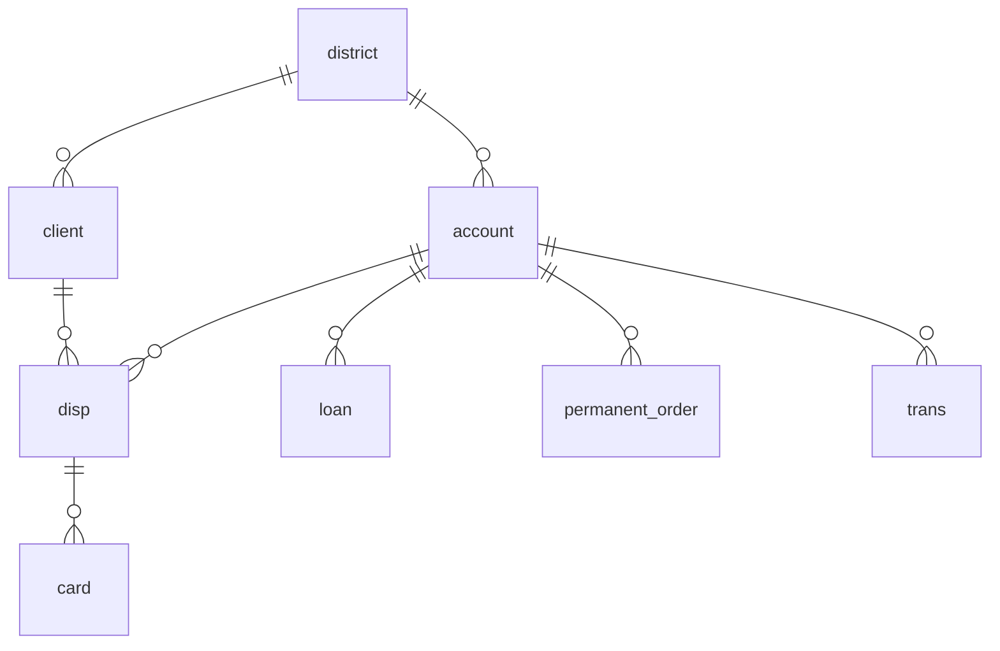

# Czech Bank: credit risk analysis in SQL

I built this project to practise SQL on data that looks like what a bank actually has: several related tables, messy values, and a lot of transactions. The data comes from a real Czech bank (anonymized) and covers 1993 to 1998: 4,500 accounts, 682 loans and just over a million transactions.

Everything is done in PostgreSQL. I loaded the raw files, cleaned them in a separate schema, and then tried to answer one question from several angles: what makes a loan go bad?

## What I found

The clearest signal was not in the loan itself but in the account before the loan was granted. Of the 29 loans whose account had been charged penalty interest (a negative balance) before the loan date, 26 went bad. For all other loans it was 7.7%. The lowest balance in the 90 days before the loan tells a similar story: below 5,000 CZK, 59% of loans went bad; above 20,000 CZK, under 5%.

Other results, roughly in order of how much they mattered:

- Loan amount: 7.5% of loans below 100k CZK went bad, against 20.7% for loans of 300k and more.
- Age of the borrower: a U shape. Highest for 18 to 24 year olds (15.7%), lowest at 25 to 34 (8.4%), going up again after 55 (14.1%).
- Region: small differences, and the groups are small enough that most of them could be chance. North Moravia stands out less for its rate than for its size: it has 17% of all loans and 18 of the 76 bad ones.
- Loan duration and gender: almost no difference.

Overall 76 of 682 loans are bad (11.1%), but this number is too low. Loans granted in 1998 had no time to go bad yet (2.5%), and without them the rate is 13.7%.

## Things that went wrong along the way

A few results looked fine at first and turned out not to be:

- My first version of the penalty interest check counted penalties at any time, including after the loan. It caught 72 of 76 bad loans, which looked great. It was useless: those penalties are a result of not paying, not something the bank could know when it decided. Adding one date condition fixed it.
- When I checked whether each balance equals the previous balance plus the transaction amount, only 49.5% matched. The most common gaps were -14.60, -30.00 and -100.00, which are the monthly statement fees. The data has dates but no times, and I was ordering same-day transactions by id, so fees landed before the interest credited on the same day. Putting credits first raised the match rate to 88.7%, or 92.9% if I allow a 0.10 CZK difference. I could not explain the remaining 7%.
- 30 loans belong to account owners aged 13 to 17 at the loan date. I don't know why (probably the anonymization of birth numbers), so I kept them as a separate group instead of removing them.

## How the database is set up

There are two schemas:

- `raw` holds the files exactly as they came: dates like `930705`, labels in Czech, `?` for missing values.
- `clean` is rebuilt from `raw` every time `04_create_clean_tables.sql` runs. It has real dates, English labels, keys between tables, gender and birth date decoded from the Czech birth number (women have 50 added to the month), and a `is_bad_loan` flag (status B or D).



The view `clean.loan_overview` joins each loan with the account owner and the branch district, so the analyses don't repeat the same joins.

## Files

```
01_create_database.sql
02_create_raw_tables.sql
03_load_raw_data.sql
04_create_clean_tables.sql
05_data_quality_check.sql
analysis/
    01_bad_loans_by_amount_and_duration.sql
    02_bad_loans_by_region.sql
    03_bad_loans_by_client_age_and_gender.sql
    04_risk_ranking_of_regions_and_districts.sql
    05_loan_portfolio_over_time.sql
    06_penalty_interest_before_loan.sql
    07_account_behaviour_before_loan.sql
    08_balance_consistency_check.sql
```

Each analysis file starts with the question and ends with what I found.

## Running it

You need PostgreSQL (I used version 18) and `psql`. The data files are not in the repo; they are available from the [PKDD'99 Discovery Challenge](https://sorry.vse.cz/~berka/challenge/pkdd1999/berka.htm) or the [CTU Relational Dataset Repository](https://relational.fel.cvut.cz/dataset/Financial). Put the eight `.asc` files in a `data/` folder and run from the project folder:

```bash
psql -U postgres -f 01_create_database.sql
psql -U postgres -d czech_bank -f 02_create_raw_tables.sql
psql -U postgres -d czech_bank -f 03_load_raw_data.sql
psql -U postgres -d czech_bank -f 04_create_clean_tables.sql
```

After that, the checks and analyses can be run in any SQL client.

Sebastian Baranski, Informatics and Econometrics student, University of Gdansk
